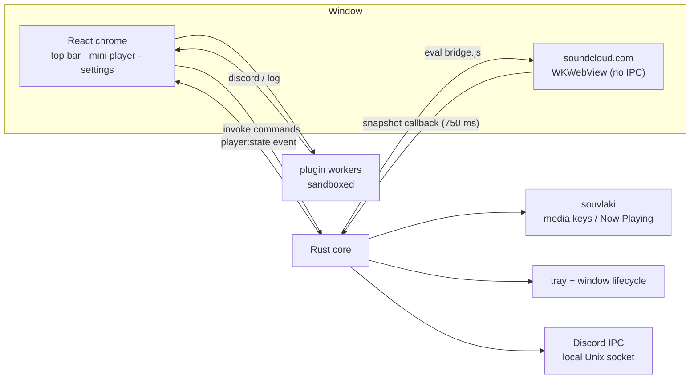

<p align="center">
  
</p>

<h1 align="center">SoundKloud</h1>

<p align="center">
  A lightweight, native macOS desktop player for SoundCloud.<br>
  Built with Tauri 2, React and TypeScript — no Electron, no bundled Chromium, no downloads.
</p>

<p align="center">
  <a href="https://tauri.app"></a>
  
  
  
</p>

SoundKloud wraps the **official SoundCloud web player** in a native macOS window and adds the pieces a browser tab does not give you: a compact mini player, media keys, Now Playing integration, a menu-bar icon and a sandboxed plugin system. It uses the system WebKit view, so the whole app is about **3.5 MB** instead of hundreds of megabytes.

> The app is intentionally a thin shell around soundcloud.com. It does not download tracks, extract audio streams, bypass DRM, or evade regional licensing. If SoundCloud says a track is unavailable in your country, SoundKloud will say the same.

Vietnamese end-user guide: [`docs/README.md`](docs/README.md).

---

## Features

| | |
| --- | --- |
| **Real SoundCloud, real login** | The page runs in a `WKWebView` with a Safari user agent. Cookies, OAuth, playback and recommendations behave like Safari. No credentials are ever read or stored by the app. |
| **Mini player** | Artwork, title, artist, play/pause, previous/next, seek and volume in a fixed bottom bar. |
| **macOS media keys** | Play/Pause, Next and Previous are routed to SoundCloud through [`souvlaki`](https://github.com/Sinono3/souvlaki). Now Playing shows track metadata and artwork in Control Center. |
| **Menu-bar app** | Closing the window hides it to the tray instead of quitting. The tray menu exposes show/hide, transport controls, Settings and Quit. |
| **Dark UI + accent colors** | Compact React chrome, six accent presets plus a custom color picker. |
| **Plugin system** | Drop a folder with `manifest.json` + `index.js` into the plugins directory. Plugins run in a Web Worker with network primitives removed and receive `onTrackChange`, `onPlay` and `onPause` hooks. |
| **Discord Rich Presence (sample)** | Ships disabled by default. Shows the current track on your Discord profile; it never controls playback. |
| **Resilient by design** | A plugin crash only kills its own worker. A SoundCloud navigation failure shows a reload screen instead of a blank window. Configured OAuth popups use native WebKit windows. |

## Non-goals

These are deliberate product decisions, not missing features. PRs that add them will not be merged:

- Downloading tracks or extracting audio URLs.
- DRM circumvention or region unlocking (proxies, VPN switching, country-header spoofing, borrowed sessions).
- Reading, exporting or uploading SoundCloud credentials/cookies.
- Running arbitrary remote code outside the plugin sandbox.

## Requirements

- macOS 11 or newer (tested on macOS 15, Apple Silicon)
- Xcode Command Line Tools
- Node.js 20/22 + pnpm 9/10
- Rust stable ≥ 1.77
- Rust target `aarch64-apple-darwin`

```bash
xcode-select --install
corepack enable
corepack prepare pnpm@latest --activate
curl --proto '=https' --tlsv1.2 -sSf https://sh.rustup.rs | sh
rustup target add aarch64-apple-darwin
```

## Quick start

```bash
git clone https://github.com/thevalk3strange-creator/soundkloud.git
cd soundkloud
pnpm install
pnpm icons          # first run only / after changing app-icon.png
pnpm tauri dev
```

`pnpm tauri dev` starts Vite on `http://localhost:1420` and opens the app. The first Rust build takes a few minutes; later builds are incremental.

### Production build

```bash
pnpm tauri build --target aarch64-apple-darwin
```

Artifacts:

```
src-tauri/target/aarch64-apple-darwin/release/bundle/macos/SoundKloud.app
src-tauri/target/aarch64-apple-darwin/release/bundle/dmg/SoundKloud_0.1.0_aarch64.dmg
```

The bundle is unsigned. On another Mac, Gatekeeper will complain — see [`docs/README.md`](docs/README.md#4-gatekeeper-với-app-chưa-ký) for the quarantine, right-click-open and ad-hoc signing commands.

### Checks

```bash
pnpm build                     # tsc --noEmit + vite build
cd src-tauri && cargo check    # Rust
```

## Architecture

SoundKloud uses **two isolated webviews** and a Rust core:



Key points:

1. **The SoundCloud webview has no Tauri IPC access.** It is not covered by any capability entry. Rust injects `bridge.js` at document start and reads state through `eval_with_callback`.
2. **The bridge is passive.** It captures the `MediaSession` action handlers and position state that SoundCloud registers itself, falling back to the `<audio>` element and, only if necessary, DOM clicks. Playback logic stays SoundCloud's.
3. **Rust polls a snapshot every 750 ms**, stores it in `PlayerStore`, and emits `player:state` to React. The UI interpolates the position between snapshots so the progress bar stays smooth.
4. **Media keys and Now Playing** live on a dedicated worker thread in `media.rs`; metadata updates are queued so artwork fetching never blocks the UI.
5. **Plugins are third-class citizens on purpose.** They run in Blob-URL Web Workers with `fetch`, `XMLHttpRequest`, `WebSocket`, `EventSource` and `importScripts` removed. The only outbound capability is Discord presence via the Rust host.
6. **OAuth popups** (`accounts.google.com`, `appleid.apple.com`, `facebook.com`) are handed to WebKit with `NewWindowResponse::Allow`, which preserves `window.opener` so the provider can `postMessage` back and close itself. Background `about:blank` / Google One Tap popups are denied.

### Repository map

```
soundkloud/
├── src/                        # React + TypeScript UI
│   ├── App.tsx                 # state, events, layout sync, plugin dispatch
│   ├── components/             # TopBar, MiniPlayer, Settings, ErrorScreen, Icons
│   └── lib/
│       ├── ipc.ts              # typed wrapper around Tauri commands
│       └── pluginHost.ts       # worker sandbox + host API
├── src-tauri/
│   ├── src/
│   │   ├── lib.rs              # app setup, window events, shutdown
│   │   ├── layout.rs           # child webview geometry + popup policy
│   │   ├── player.rs           # snapshot polling and transport commands
│   │   ├── injected/bridge.js  # runs inside soundcloud.com
│   │   ├── media.rs            # media keys / Now Playing (souvlaki)
│   │   ├── discord.rs          # Discord IPC client
│   │   ├── plugins.rs          # manifest parsing, installer
│   │   ├── config.rs           # atomic JSON settings
│   │   ├── commands.rs         # IPC surface
│   │   └── tray.rs             # menu bar + show/hide
│   ├── capabilities/           # Tauri ACL (main webview only)
│   └── tauri.conf.json
├── plugins/                    # bundled example plugin (embedded via include_str!)
├── scripts/generate-icons.mjs
└── docs/README.md              # Vietnamese user guide
```

### IPC surface

All commands are defined in `src-tauri/src/commands.rs` and wrapped by `src/lib/ipc.ts`:

`get_config`, `save_config`, `app_info`, `get_player_state`, `player_command`, `browser_reload`, `browser_back`, `browser_forward`, `browser_home`, `set_browser_visible`, `set_layout`, `open_external`, `open_plugins_dir`, `list_plugins`, `set_plugin_enabled`, `set_plugin_config`.

Add a command in Rust, register it in `lib.rs`, then extend `ipc.ts` — never call `invoke` with a raw string from components.

## Data and configuration

```
~/Library/Application Support/com.gamvoc.soundkloud/
├── config.json
└── plugins/
    ├── README.md
    └── discord-rich-presence/
        ├── manifest.json
        └── index.js
```

`config.json` is written atomically (temp file + rename) and sanitized on load:

```json
{
  "accent": "#8b5cf6",
  "miniPlayer": true,
  "volume": 0.8,
  "hideToTray": true,
  "plugins": {},
  "pluginConfig": {}
}
```

Deleting the folder resets settings and installed plugins. SoundCloud cookies live in the WebKit data container and are unaffected — sign out from the website if needed.

## Writing a plugin

Open **Settings → Plugins → Open plugins folder**, create `my-plugin/manifest.json` and `index.js`, then reload plugins.

```json
{
  "id": "hello",
  "name": "Hello Track",
  "version": "1.0.0",
  "description": "Logs the current track.",
  "author": "you",
  "main": "index.js",
  "hooks": ["onTrackChange", "onPlay", "onPause"],
  "settings": [],
  "enabledByDefault": false
}
```

```js
registerHooks({
  onTrackChange({ track }) {
    api.log("info", `Now playing: ${track.title} — ${track.artist}`);
  },
  onPause() {
    api.log("info", "Paused");
  }
});
```

Available host API: `registerHooks`, `api.log(level, ...args)`, `api.config`, `api.discord.setActivity(activity)`, `api.discord.clear()`. Full payload and limits: [`plugins/README.md`](plugins/README.md).

Plugins cannot touch the DOM, the network or the SoundCloud session. A thrown error is logged in **Settings → Recent plugin activity** and only disables that plugin's worker.

## Known limitations

- **Passkeys / Touch ID do not work.** WebAuthn in a third-party `WKWebView` requires Apple's `com.apple.developer.web-browser.public-key-credential` entitlement. Use "Try another way" (password or phone approval) or sign in to SoundCloud with email + password.
- **Geo-blocked tracks stay blocked.** This is server-side licensing, not something a client can fix legitimately.
- **Unsigned builds trigger Gatekeeper.** Use right-click → Open or clear the quarantine attribute.
- **Only the Apple Silicon target is configured.** Intel works in principle; add `x86_64-apple-darwin` and build for it.
- **SoundCloud DOM changes can break fallbacks.** The MediaSession path is stable; the DOM click fallback is best-effort.
- **The native SoundCloud player stays visible** above the custom mini player. Hiding it was deliberately avoided to keep playback stable.
- **macOS only for now.** The Rust code is mostly portable (souvlaki supports Linux/Windows), but the tray, window chrome and build config target macOS.

## Contributing

Contributions are welcome — bug reports, UI polish, docs, plugins and platform ports. Start with [`CONTRIBUTING.md`](CONTRIBUTING.md), then open an issue before starting anything large so we can agree on the approach.

Good first areas:

- UI: keyboard shortcuts, compact mode, better error states.
- Playback: handling ads, reposts and 30-second previews more gracefully.
- Plugins: new sample plugins (Last.fm scrobbling would need a host-side network bridge), manifest validation.
- Tooling: GitHub Actions for `pnpm build` + `cargo check`, integration tests for the bridge parser.
- Platform: Windows/Linux support.

## License

[MIT](LICENSE) © 2026 thevalk3strange-creator

SoundKloud is an unofficial client. SoundCloud and the SoundCloud logo are trademarks of SoundCloud Global Limited & Co. KG. This project is not affiliated with or endorsed by SoundCloud.
